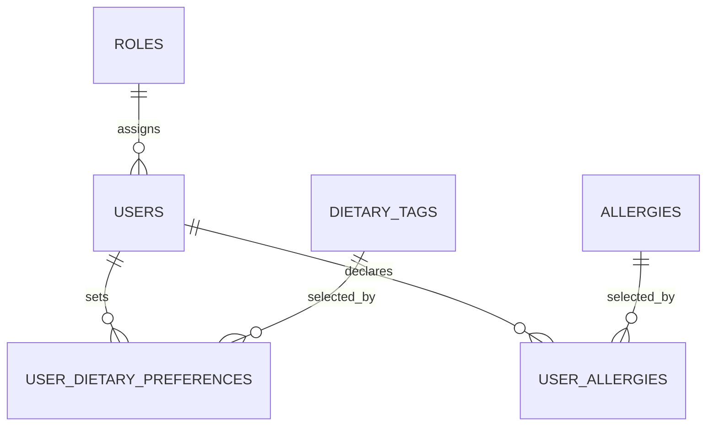

# ERD 1 — Accounts and preferences

## What this part does

It records who the user is and the food restrictions that affect recommendations.

## Simple explanation

> Every user has one role. A user can choose many dietary preferences and allergies, and the same preference or allergy can belong to many users. The two link tables prevent the same choice being saved twice.

## Key design points

| Table | Important keys / fields | Why it exists |
| --- | --- | --- |
| `roles` | `role_id` (PK), `role_name` (UK) | Separates student, contributor and administrator permissions. |
| `users` | `user_id` (PK), `role_id` (FK), `email` (UK), `display_name` | Stores one account without storing a plaintext password. |
| `user_dietary_preferences` | `(user_id, dietary_tag_id)` (composite PK) | Connects users with many dietary tags without duplicate selections. |
| `user_allergies` | `(user_id, allergy_id)` (composite PK) | Records safety-critical allergy declarations. |

## Current status

🟡 The MySQL design is ready. The current FastAPI prototype still has a temporary SQLite `students` table, so this is the target structure for the later MySQL integration.

[Back to ERD guide](../ERD.md)
