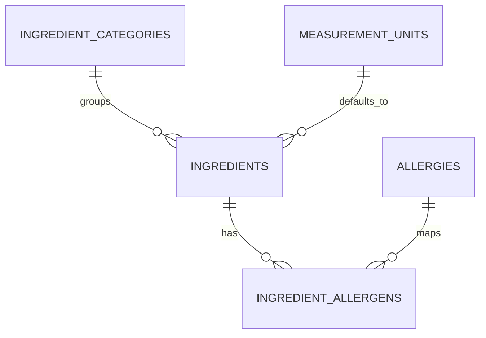

# ERD 2 — Ingredients and safety

## What this part does

It keeps ingredients reusable and gives every quantity a consistent unit and safety label.

## Simple explanation

> An ingredient is shared master data: rice is entered once and can appear in many recipes. It belongs to a category, has a default unit such as grams or pieces, and can be connected to one or more allergens for safe recommendations.

## Key design points

| Table | Important keys / fields | Why it exists |
| --- | --- | --- |
| `ingredients` | `ingredient_id` (PK), category/unit FKs, `estimated_unit_cost` | Stores the reusable ingredient, its default measurement and a reference cost. |
| `measurement_units` | `measurement_unit_id` (PK), `unit_symbol` (UK) | Stops `g`, `gram` and `grams` being treated as different units. |
| `ingredient_allergens` | `(ingredient_id, allergy_id)` (composite PK) | Models multiple allergens per ingredient without duplication. |

## Current status

The API calculates recipe and shopping costs from MySQL ingredient prices. The reference price is separate from the actual price paid on a shopping-list item. The frontend v6 migration adds controlled allergy options and known positive ingredient mappings. Compound products require label review; missing links do not mean allergen-free. See [the database guide](../README.md).

The allergy-warning migration keeps standard option names and the known links in sync with existing installations. `allergies` and `ingredients` use case-insensitive unique names, with checks against blanks and surrounding spaces. `No known allergies` is represented by no `user_allergies` row, never by an allergy option. Recipe tags are derived from the ingredient links rather than stored separately.

[Back to ERD guide](../ERD.md)
