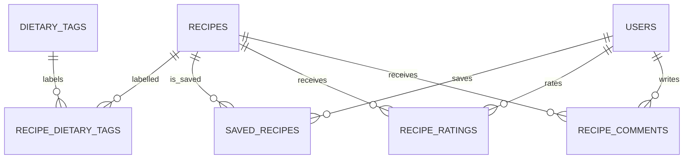

# ERD 4 — Recipe discovery and feedback

## What this part does

It supports recipe filtering, favourites, ratings and comments.

## Simple explanation

> Tags make searches such as Vegetarian or Vegan reliable. Favourites, ratings and comments are all user-to-recipe relationships. Their composite keys mean one user cannot save or rate the same recipe twice.

## Key design points

| Table | Important keys / fields | Why it exists |
| --- | --- | --- |
| `recipe_dietary_tags` | `(recipe_id, dietary_tag_id)` (composite PK) | Lets one recipe carry multiple search filters. |
| `saved_recipes` | `(user_id, recipe_id)` (composite PK) | Provides the Dashboard favourites list. |
| `recipe_ratings` | `(user_id, recipe_id)` (composite PK), rating 1–5 | Allows average score and rating count to be calculated instead of duplicated in `recipes`. |
| `recipe_comments` | recipe/user FKs, text, hidden flag | Supports the future detail-page discussion. |

## Current status

✅ Recipe Library has title, cuisine, price, difficulty and tag filters in the UI. 🟡 It currently uses mock data; the MySQL API should aggregate ratings and tags when returning a card.

[Back to ERD guide](../ERD.md)
