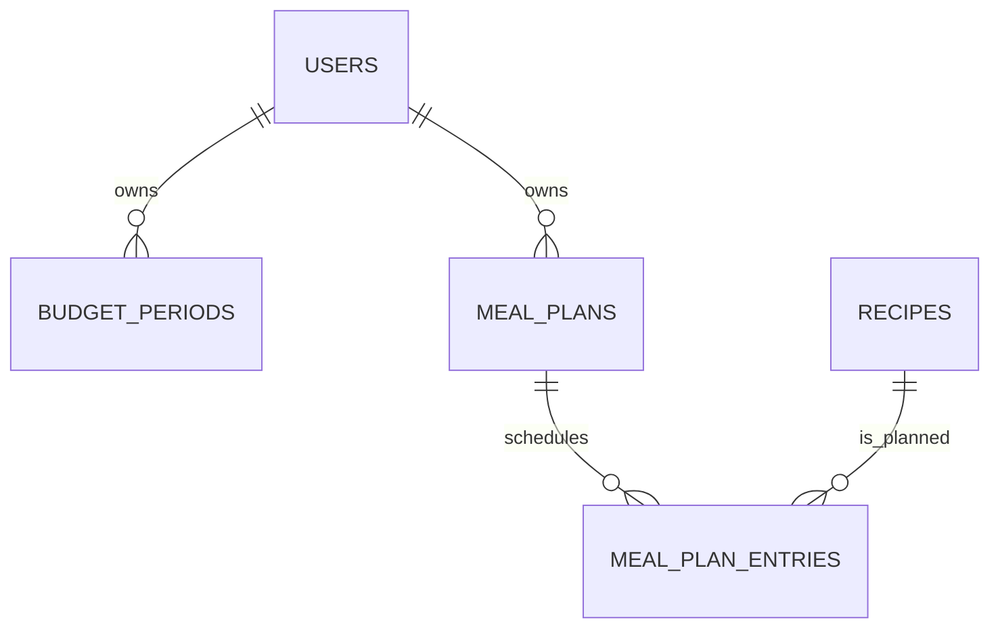

# ERD 5 — Meal planning and budget

## What this part does

It puts recipes into a user's weekly calendar and gives that week a spending limit.

## Simple explanation

> A user can create one meal plan for each week. Every entry assigns one recipe to a date and a meal slot, such as Monday dinner. The database stops two recipes being put into the same plan/date/meal slot.

## Key design points

| Table | Important keys / fields | Why it exists |
| --- | --- | --- |
| `budget_periods` | user FK, start/end dates, `budget_amount` | Stores a budget for a defined time period rather than permanently on the user. |
| `meal_plans` | user FK, `week_start_date` (UK with user) | Gives each user one named plan per week. |
| `meal_plan_entries` | plan/recipe FKs, planned date, meal type | Stores the actual calendar slot and planned serving count. |

## Current status

✅ Dashboard already displays a budget card and a “Plan my week” action. 🟡 Calendar and Budget pages are still placeholders. During integration, “tonight's recipe” comes from today's dinner entry, not from a duplicate `is_tonight` flag on a recipe.

[Back to ERD guide](../ERD.md)
