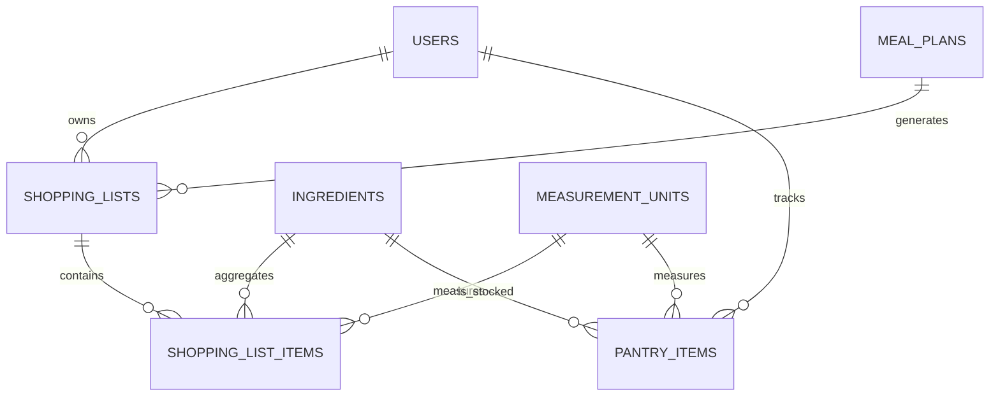

# ERD 6 — Shopping and pantry

## What this part does

It turns a meal plan into a grocery list, records purchases and tracks food already at home.

## Simple explanation

> A shopping list belongs to one user and may be generated from a meal plan. Each item stores its quantity, costs and whether it was purchased. Pantry items are separate because they represent food the student already owns, not food they still need to buy.

## Key design points

| Table | Important keys / fields | Why it exists |
| --- | --- | --- |
| `shopping_lists` | user/meal-plan FKs, status | Keeps generated lists separate from completed history. |
| `shopping_list_items` | list/ingredient/unit FKs, quantity, estimated/actual cost | Preserves both planned and real spending. |
| `pantry_items` | user/ingredient/unit composite UK, quantity, expiry | Stops duplicate stock rows for the same user, ingredient and unit. |

## Current status

✅ The FastAPI prototype can already merge identical ingredients across selected recipes. 🟡 It does not yet save that result to MySQL, and the Shopping List page is still a placeholder.

[Back to ERD guide](../ERD.md)
