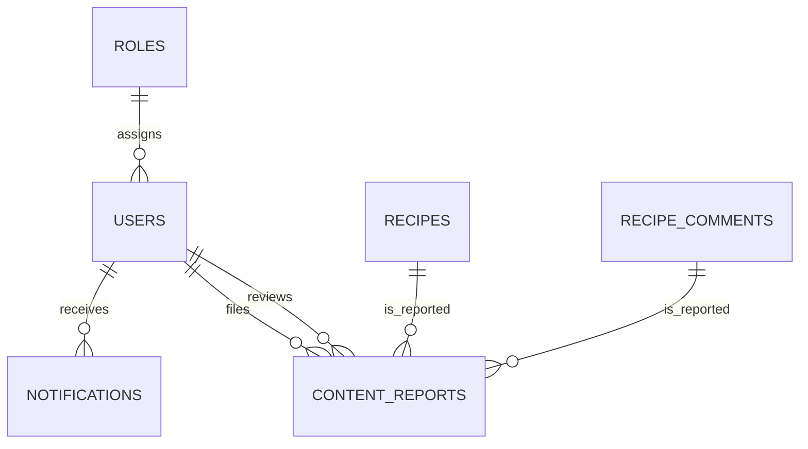

# ERD 7 — Administration and notifications

## What this part does

It provides reminder delivery and a safe way to report inappropriate recipes or comments.

## Simple explanation

> Users can receive reminders and report unsuitable content. A report targets exactly one recipe or one comment, and an administrator can record who reviewed it and what decision was made.

## Key design points

| Table | Important keys / fields | Why it exists |
| --- | --- | --- |
| `notifications` | user FK, type, scheduled/read times | Supports meal and shopping reminders. |
| `content_reports` | reporter/reviewer FKs, target FKs, status | Stores the moderation workflow. |
| `content_reports` constraint | exactly one target must be non-null | Prevents one report from ambiguously pointing to both a recipe and a comment. |

## Current status

○ Admin, reporting and notification screens have not been implemented yet. The schema is ready so they can be added without redesigning the core recipe data.

[Back to ERD guide](../ERD.md)
