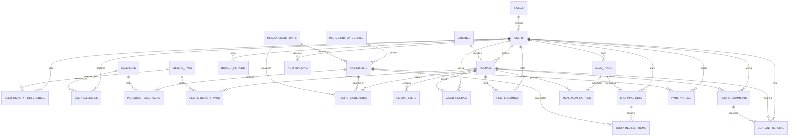

# UniMeal Planner ERD

This is the authoritative logical ERD for the MySQL schema in `database/master_schema.sql`. The Database Architect owns schema changes; other team members should propose changes rather than editing the master script directly.

## Design decisions

- All many-to-many relationships use junction tables with composite primary keys, preventing duplicate selections, tags, favourites, ratings, or allergen declarations.
- `recipe_ingredients` carries quantity and unit because they belong to the recipe-ingredient relationship, not to either parent entity.
- Meal-plan entries are unique per meal slot, and shopping lists retain generated quantities and actual purchase costs to preserve spending history.
- Passwords are represented only by `password_hash`; the database rejects values shorter than 20 characters. The API must apply Argon2 or bcrypt before insertion.
- The user and ingredient preference tables support the AI recommendation module without exposing user passwords or unnecessary personal data.
