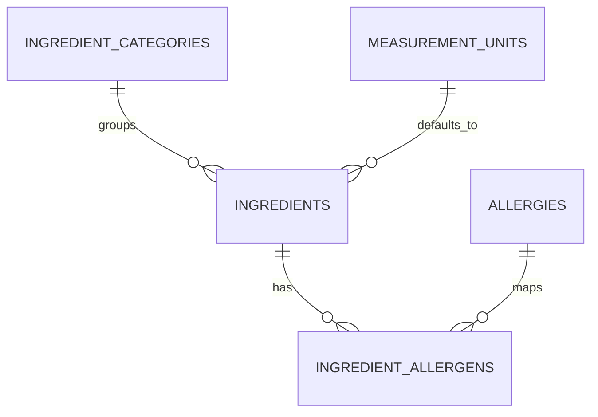

# ERD 2 — Ingredients and safety

## What this part does

It keeps ingredients reusable and gives every quantity a consistent unit and safety label.

## Simple explanation

> An ingredient is shared master data: rice is entered once and can appear in many recipes. It belongs to a category, has a default unit such as grams or pieces, and can be connected to one or more allergens for safe recommendations.

## Key design points

| Table | Important keys / fields | Why it exists |
| --- | --- | --- |
| `ingredients` | `ingredient_id` (PK), category/unit FKs, `estimated_unit_cost` | Stores the reusable ingredient, its default measurement and a reference cost. |
| `measurement_units` | `measurement_unit_id` (PK), `unit_symbol` (UK) | Stops `g`, `gram` and `grams` being treated as different units. |
| `ingredient_allergens` | `(ingredient_id, allergy_id)` (composite PK) | Models multiple allergens per ingredient without duplication. |

## Current status

✅ The API prototype already calculates recipe and shopping costs from ingredient prices. 🟡 The MySQL schema adds shared units, categories and allergen safety checks. The reference price is separate from the actual price paid on a shopping-list item.

[Back to ERD guide](../ERD.md)
