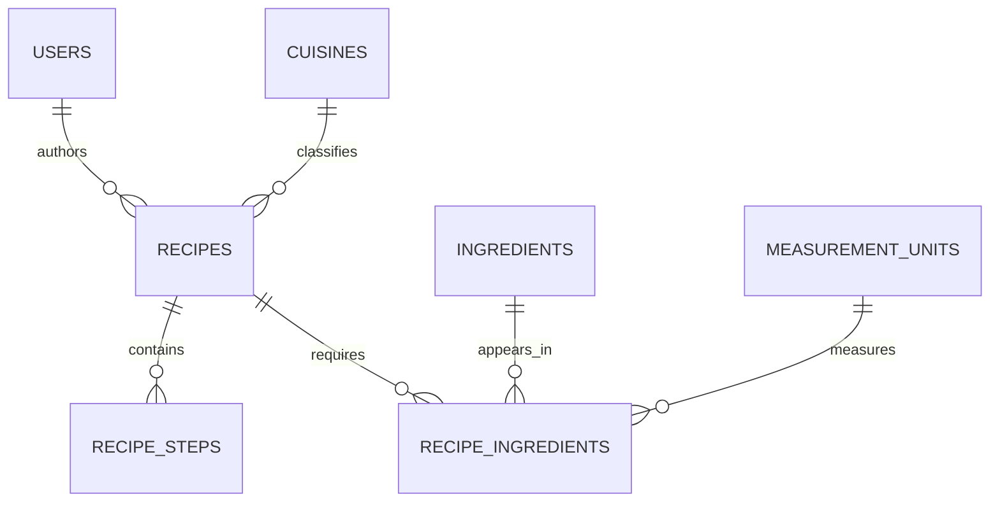

# ERD 3 — Recipe authoring

## What this part does

It describes how a contributor creates a complete recipe with a cuisine, ordered steps and measured ingredients.

## Simple explanation

> A recipe is the centre of this diagram. One contributor can write many recipes; every recipe can have many ordered steps and many ingredients. Quantity and unit are stored in `recipe_ingredients` because 200 grams of rice belongs to a particular recipe, not to rice in general.

## Key design points

| Table | Important keys / fields | Why it exists |
| --- | --- | --- |
| `recipes` | author/cuisine FKs, `image_url`, time, servings, difficulty, status | Holds the main recipe-card and detail-page data. |
| `recipe_steps` | `(recipe_id, step_number)` (UK) | Keeps instructions ordered and prevents two step 1 records. |
| `recipe_ingredients` | recipe/ingredient/unit FKs, quantity, `sort_order` | Records the exact measured ingredients required for a recipe. |

## Current status

✅ The frontend already shows recipe cards; the recipe-detail and submission pages are still placeholders. The new `recipes.image_url` field supplies the image used by the current cards.

[Back to ERD guide](../ERD.md)
